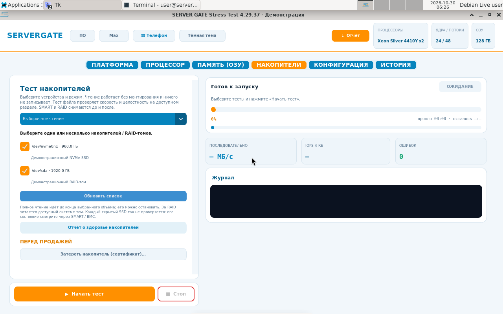
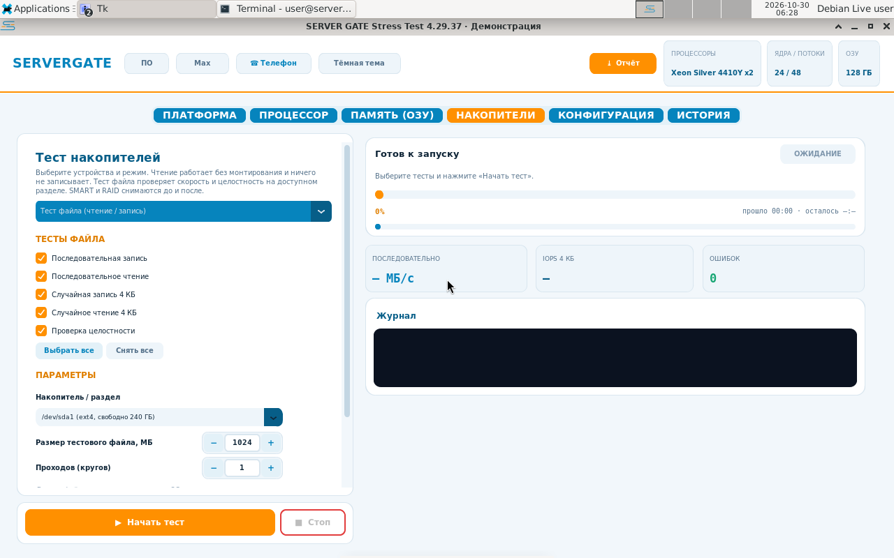
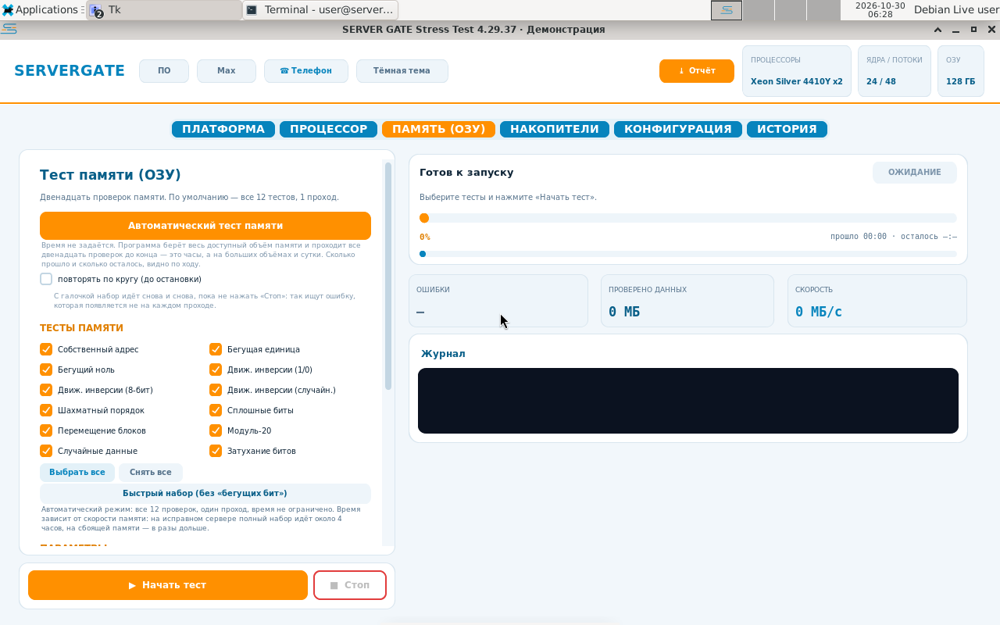
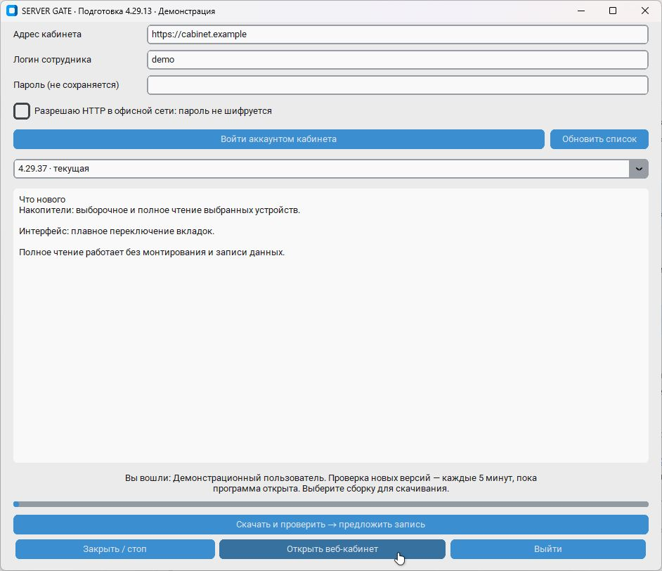

# SERVER GATE Stress Test

**Конфигурация сервера → диагностика → нагрузка → единый отчёт**

<kbd>Stress Test 4.29.37</kbd> &nbsp; <kbd>Подготовка флешки 4.29.13</kbd>

[Что нового](NEWS.md) · [Галерея](#галерея) · [Как устроена проверка](#как-устроена-проверка)

SERVER GATE Stress Test объединяет диагностику серверного оборудования,
нагрузочные тесты и оформление результатов. Специалист загружает сервер,
выбирает проверки и получает HTML-документ с конфигурацией, результатами
и обнаруженными отклонениями.

> **Ознакомительный репозиторий.** Здесь публикуются обзор, новости и
> демонстрационные снимки. Исходники, исполняемые файлы и загрузочные
> образы через этот репозиторий не распространяются.

## Обновление 4.29.37 · 29 октября 2026

Главное изменение — отдельный выбор устройств и способа проверки
во вкладке **«Накопители»**. Теперь удобно проверить один диск,
несколько накопителей или доступный системе RAID-том.

*Демонстрация загрузочной среды: выбор устройств перед запуском. На снимке
показаны вымышленные накопители, тест не запущен.*

| Задача | Как решается сейчас |
|---|---|
| Быстро проверить чтение выбранного устройства | Выборка участков по поверхности, с указанием фактического охвата |
| Прочитать весь доступный объём | Полное чтение до конца устройства; тест можно остановить |
| Измерить чтение, запись и IOPS | Отдельный режим теста файла на смонтированном разделе |
| Переключаться между страницами | Подготовка вкладки до показа и повторное использование её раскладки |
| Получить актуальную сборку сотруднику | Вход в программу подготовки тем же аккаунтом, что и в веб-кабинет |

Режимы прямого чтения доступны в загрузочном образе Linux: монтировать
или форматировать проверяемое устройство не требуется. **За аппаратным
RAID читается том, доступный операционной системе.** Состояние отдельных
скрытых SSD уточняется через SMART и подключение к BMC — возможности
зависят от контроллера и его прошивки.

[Подробнее об обновлении и предыдущих изменениях →](NEWS.md)

## Галерея

### Скорость и целостность данных

В режиме теста файла доступны последовательные и случайные операции,
измерение IOPS и запись шаблона с последующей сверкой. Нужен доступный
для записи смонтированный раздел. Этот режим используется и в Windows.

<strong>Посмотреть настройки теста файла</strong>

*Демонстрационный раздел и параметры; операции с накопителем не выполняются.*

### Память: автоматический тест, время и повторение

Двенадцать проверок памяти можно выполнить полным набором, настроить
тестирование по времени или повторять выбранную последовательность
до остановки оператором.

<strong>Посмотреть вкладку памяти</strong>

*Интерфейс 4.29.37. Состав оборудования демонстрационный, нагрузка не запущена.*

### Программа подготовки: аккаунт, версии, описание изменений

В подготовке **4.29.13** верхняя кнопка использует аккаунт веб-кабинета.
После входа доступны опубликованные для сотрудника версии и описание
изменений. Новые версии проверяются каждые пять минут, пока программа
открыта. Скачанный образ проверяется по SHA-256, запись — контрольным чтением.

*Демонстрационный адрес `cabinet.example` и вымышленная учётная запись.
Пароль на снимке отсутствует. Кабинет может работать в локальной сети;
отдельный внешний хостинг для этого сценария не требуется.*

## Как устроена проверка

| Этап | Что получает специалист |
|---|---|
| **Конфигурация** | Процессоры, установленные модули памяти, накопители, контроллеры, питание и доступные прошивки |
| **Диагностика** | Состояния компонентов, ошибки ECC, аппаратные события и доступные показания датчиков |
| **Нагрузка** | Тесты CPU, памяти и накопителей; совместная нагрузка и длительные повторяющиеся сценарии |
| **Результат** | Единый HTML-отчёт с паспортом оборудования, выполненными проверками и итогом |

Недоступные данные сопровождаются пояснением. Охват чтения указывается
в результате. Диск вне массива сам по себе не считается неисправным.
Для накопителей за контроллером различаются физический диск и логический том.

### Сведения от контроллера управления

При явном подключении к совместимому BMC по адресу, логину и паролю
программа получает дополнительные сведения: накопители и массивы,
отсеки, питание, память, охлаждение, прошивки и уровень лицензии
контроллера. Эти данные используются в конфигурации и общем отчёте.

Доступность конкретных полей зависит от платформы, контроллера и прошивки.
Для SSD BOSS через iDRAC могут быть доступны сведения об отдельных дисках,
которые операционная система видит только как общий RAID-том.

### Отчёт для дальнейшей работы

HTML-документ формируется локально и объединяет паспорт сервера,
конфигурацию, историю выполненных тестов, температурные показатели
и обнаруженные отклонения. Его можно просмотреть, распечатать
или передать вместе с оборудованием.

## Статус и границы

Проект проходит внутреннее тестирование на серверном оборудовании.
Основные стенды — HPE ProLiant и Dell PowerEdge; набор доступных
проверок определяется оборудованием и поддержкой со стороны системы.
Полный набор возможностей рассчитан на загрузочную среду Linux.
У Windows-версии есть ограничения диагностики и доступа к устройствам.

**Все новые снимки на этой странице сделаны в демонстрационной среде.**
Они показывают интерфейс и настройки, а не результаты проверки сервера
заказчика. ФИО клиентов, реальные серийные номера, внутренние адреса,
лицензионные ключи и пароли в эти материалы не включены.

## Правовая информация

SERVER GATE и связанные графические материалы являются собственностью
правообладателя. Названия сторонних производителей и продуктов принадлежат
их владельцам и используются для обозначения совместимости.

© 2026 SERVER GATE. Все права защищены.
